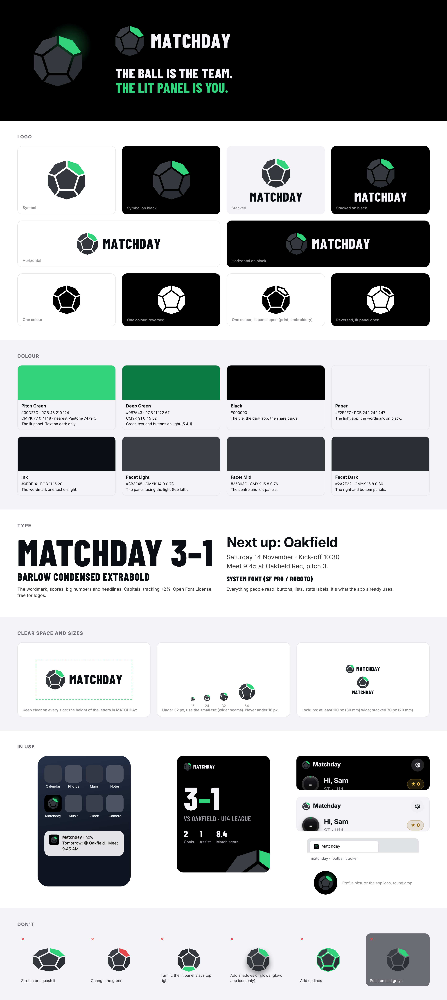
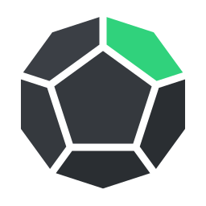
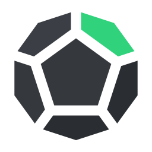

# Matchday brand

**The ball is the team. The lit panel is you.**

Matchday's mark is a faceted ball: the six panels a regular dodecahedron shows
face-on, lit from the top left, with one panel lit pitch green. Everything else
in the brand follows from that: black and dark greys, one green, and condensed
capitals for the big moments.

## The logo

| | File | Use it for |
|---|---|---|
|  | `logo/symbol.svg` | The mark on its own, at 32 px and up, on black, white or Paper |
|  | `logo/symbol-small.svg` | 16–31 px: wider seams so the panels don't fill in |
| | `logo/lockup-horizontal-{dark,light}.svg` | The usual way to write the name: the ball, then MATCHDAY |
| | `logo/lockup-stacked-{dark,light}.svg` | Square spaces: the ball over the name |
| | `logo/wordmark-{paper,ink}.svg` | The name alone, where the ball is already nearby |
| | `logo/*-black.svg`, `logo/*-white.svg` | One colour: stamps, laser-cutting, the notification badge |
| | `logo/symbol-{black,white}-open.svg` | One colour, big: print and embroidery. The lit panel is drawn open so it's still the different one |

`-dark` versions go on black or dark photos, `-light` versions on white or Paper.

### How it's built

- **Panels:** a regular dodecahedron seen face-on. The centre pentagon points
  straight up, and the lit panel is the one at the top right.
- **Light:** comes from the top left. The top-left panel is Facet Light, the
  centre and left panels are Facet Mid, and the right and bottom panels are
  Facet Dark. Flat colours, no gradients.
- **Seams:** real gaps, not black lines, so whatever is behind shows through.
  The seam is 9/224 of the ball's width in the master and 17/236 in the small cut.
- **Glow:** only on the app icon, behind the lit panel. Never on the logo itself
  or in print.

## Colour

| Name | HEX | RGB | CMYK | Use |
|---|---|---|---|---|
| Pitch Green | `#30D27C` | 48 210 124 | 77 0 41 18 | The lit panel. Green text on dark (10.6:1 on black). Nearest Pantone: 7479 C, check against a swatch book |
| Deep Green | `#0B7A43` | 11 122 67 | 91 0 45 52 | Green text and buttons on light (5.4:1 on white) |
| Black | `#000000` | 0 0 0 | 0 0 0 100 | The app icon tile, the dark app, share cards |
| Ink | `#0B0F14` | 11 15 20 | 45 25 0 92 | The wordmark and text on light |
| Paper | `#F2F2F7` | 242 242 247 | 2 2 0 3 | The light app; the wordmark on black |
| Facet Light | `#3B3F45` | 59 63 69 | 14 9 0 73 | The top-left panel |
| Facet Mid | `#35393E` | 53 57 62 | 15 8 0 76 | The centre and left panels |
| Facet Dark | `#2A2E32` | 42 46 50 | 16 8 0 80 | The right and bottom panels |

Pitch Green is never used for text on white (2.0:1). The facet greys are
deliberately quiet on black; the green panel is what you spot first.

## Type

- **Barlow Condensed ExtraBold** for the wordmark, scores, big numbers and
  headlines: capitals, tracking +2%. It's under the SIL Open Font License, so it
  can be used in the logo. The wordmark files are already outlines.
- **The system font** (SF Pro on iPhone, Roboto on Android) for everything
  people read: buttons, lists, labels. It's what the app already uses.

## Space and size

- **Clear space:** keep a gap the height of the MATCHDAY capitals on every side
  of a lockup, and a quarter of the ball's width around the ball on its own.
- **Smallest sizes:** the ball 32 px (or 16 px with the small cut), the
  horizontal lockup 110 px or 30 mm wide, the stacked lockup 70 px or 20 mm.

## Don't

- Stretch, squash, or turn it. The lit panel always stays top right.
- Change the green, or light a different panel.
- Add shadows, glows, outlines or gradients.
- Put the colour ball on mid greys or busy photos. Use black, white, Paper, or a
  one-colour version.

## Files in the app

| App file | Made from |
|---|---|
| `src/components/Logo.tsx` | `logo/symbol.svg`, seams slightly wider since it's drawn at about 24 px |
| `public/favicon.svg` | `icons/favicon.svg`: the small cut on a rounded black tile |
| `public/icons/icon.svg` | `icons/app-icon-rounded.svg`: the opening splash |
| `public/icons/icon-192.png`, `icon-512.png` | `icons/app-icon-rounded.svg`: rounded tile, for places nothing rounds it |
| `public/icons/icon-maskable-512.png`, `apple-touch-icon.png` | `icons/app-icon.svg`: square and opaque, since phones round these themselves. The ball sits inside Android's safe circle |
| `public/icons/badge-96.png` | `icons/badge.svg`: one colour, wide seams, for Android's status bar |

Ready-made PNGs are in `png/`: the symbol and the app icon at 1024 px (app
stores, profile pictures), and the horizontal lockup at 1200 px wide.

The logo isn't trademark-checked. Before printing it on kit or merchandise, do
a trademark search and a reverse image search.
